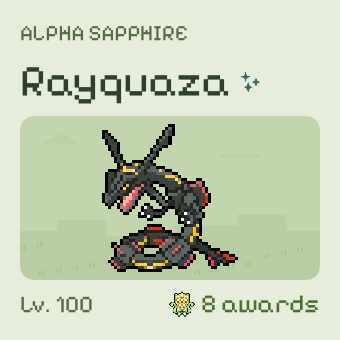
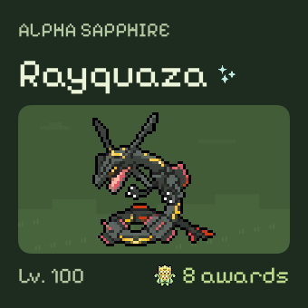
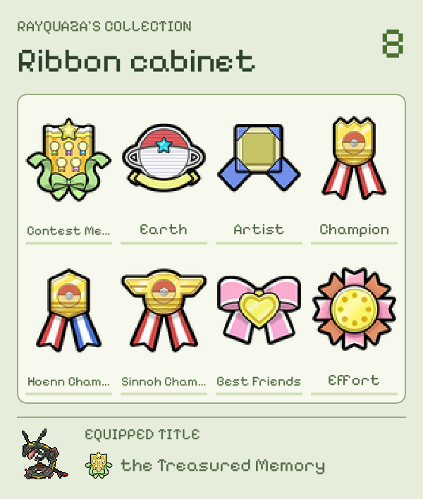
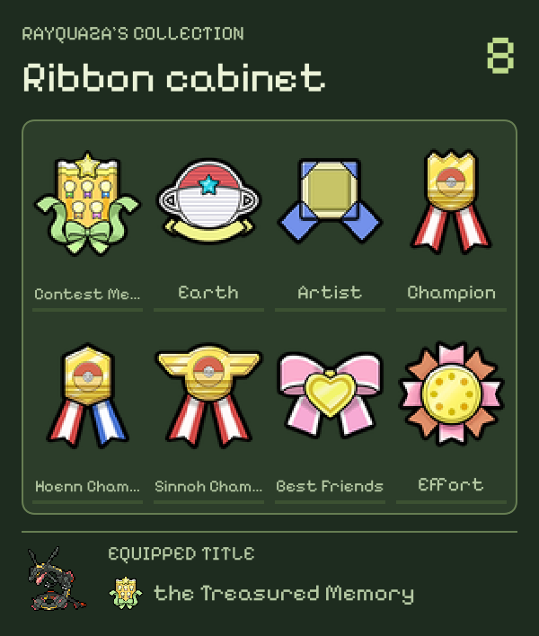
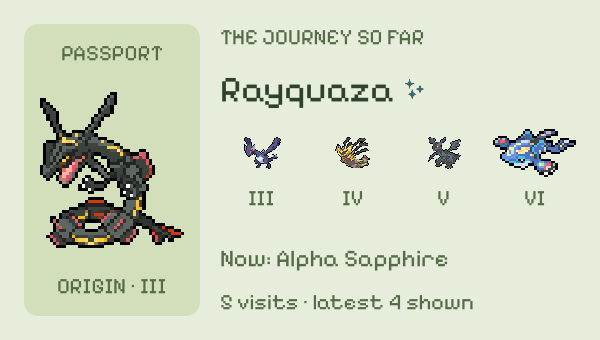
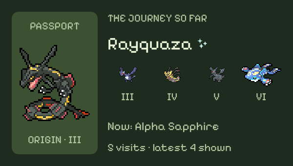
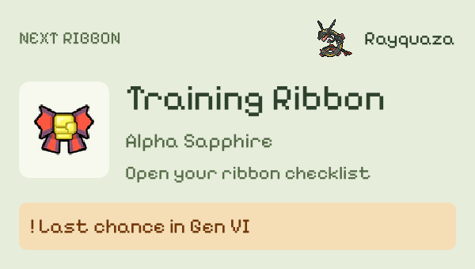
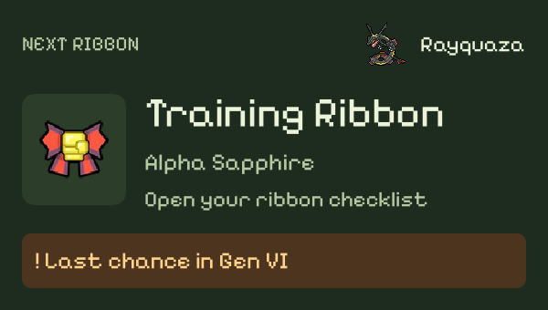

# Native widget validation — 20 October 2026

Commit tested: `0d8e50b52b422c2c53d5e661947e388dab5ebaad` on `codex/native-widget-validation`.

[GitHub Actions run](https://github.com/trafffic/RibbonPassportMain/actions/runs/39508161367) · [full result artifact](https://github.com/trafffic/RibbonPassportMain/actions/runs/39508161367/artifacts/12306040212) (three-day retention).

## Results

- macOS 15.7.9 Intel runner, Xcode 26.3, iPhone SE (3rd generation) simulator running iOS 26.2.
- App and widget extension compiled successfully after qualifying the recovery lookup as `self.kind(of:)` in `Shared/RecoveryHistory.swift`.
- **99 unit/render tests passed; zero failed or skipped.**
- **One Widget Studio interaction test passed:** `StreamlinedUIUITests/testWidgetSetupKeepsAdvancedControlsOptional`.
- Both Xcode commands printed `TEST SUCCEEDED`. The exported `unit-summary.json` and `widget-studio-summary.json` both report `Passed`.

The Actions run's overall conclusion is **cancelled**, not green. A diagnostic cancellation was requested while the most recent job snapshot still showed the combined build/test step running. Both Xcode test commands completed successfully, and image export and artifact upload also completed successfully before the job ended. The summaries retained here provide the actual test outcomes; the cancelled workflow must not be described as an overall successful Actions run.

## Visual inspection

Inspected all 24 new layout renders: Pocket companion, Ribbon cabinet, Journey ticket, and Next ribbon at 170 × 170, 300 × 170, and 300 × 354 points, in light/dark, with text scale 115%. No overlapping or out-of-bounds content was observed in these fixtures. Long cabinet ribbon names and long visited-game names truncate within their cells.

The recommended-size images below are unmodified SwiftUI `ImageRenderer` attachments exported from the native simulator tests. They use the bundled Rayquaza demo record, rather than the illustrative data from the original mockups. Their rectangular outer bounds are the renderer's frame; Home Screen widget corner clipping is provided by WidgetKit.

| Layout | Light | Dark |
| --- | --- | --- |
| Pocket companion · Small |  |  |
| Ribbon cabinet · Large |  |  |
| Journey ticket · Medium |  |  |
| Next ribbon · Medium |  |  |

The Alpha Sapphire mascot regression passed for both artwork appearances, including visible bounds, preserved aspect ratio, and the unchanged Sapphire asset. The Journey ticket images show its new scale in context. Layout persistence/legacy decoding, default independence, eligible unowned goals, last-chance priority, another earning game in the same generation, and unresolved Footprint warnings also passed.

## Coverage limits

The interactive test covers Widget Studio's customization and setup flow. It does not exercise all four layout selections interactively. The actual shared widget renderer is covered by the 24 render attachments. Home Screen placement, timeline refresh, physical-device App Group sharing, VoiceOver, and other accessibility text settings were not tested in this run.
